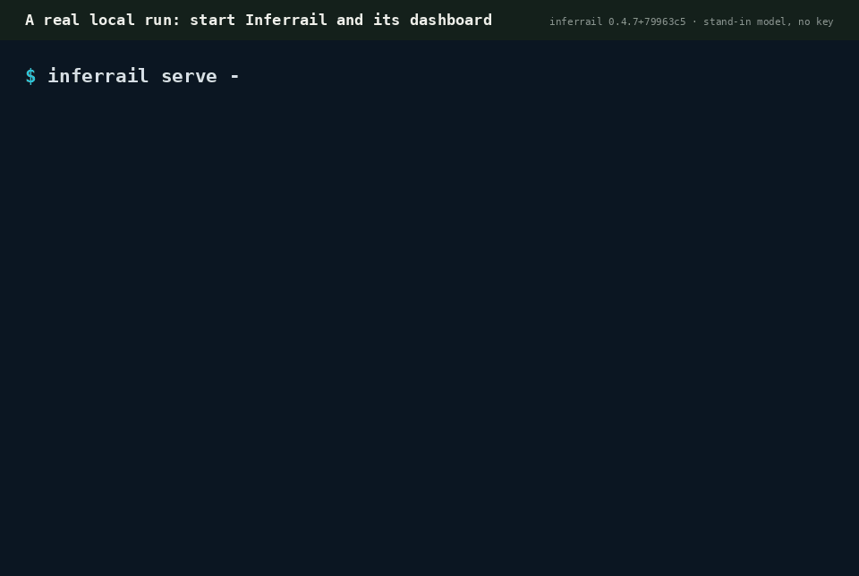

<!-- mcp-name: io.github.domondi1/inferrail -->

<p align="center"></p>
<h1 align="center">Inferrail</h1>
<p align="center"><b>External evidence for AI agents.</b><br>
Public webpages, document text and investigation data your agent can use,<br>
with structured results and transparent per-result pricing.</p>
<p align="center">
  <a href="https://github.com/domondi1/inferrail/actions/workflows/ci.yml"></a>
  <a href="https://pypi.org/project/inferrail/"></a>
  <a href="LICENSE"></a>
</p>


<p align="center">
  <a href="https://tryinferrail.com/web-read/"><b>Web Read</b></a> ·
  <a href="https://tryinferrail.com/developers/">Developer quickstart</a> ·
  <a href="https://tryinferrail.com/pricing/">Pricing</a> ·
  <a href="#self-hosted-gateway-quickstart">Inference budgets</a> ·
  <a href="https://tryinferrail.com/llms.txt">For agents</a>
</p>

Start with **Web Read**: retrieve an original public source as clean Markdown with its title,
source URL, retrieval timestamp, content hash and payment receipt. Use it for research,
document ingestion, citations and recurring documentation reads without maintaining an
extraction and payment-recovery stack. Inferrail also ships independent inference spending
controls: the Python package installs the self-hosted gateway, not the hosted evidence APIs.

## What you can use today

Verified **2026-11-28** against unpaid production challenges, live pricing and public registries.
Commercial availability and maturity are separate: the purchasable APIs remain developer preview.
Production contracts override this dated inventory.

| Product | Result / price | Live payment path | Maturity |
|---|---|---|---|
| [Web Read](https://tryinferrail.com/web-read/) | Public page or text-layer PDF as Markdown, metadata and receipt. **$0.002 per delivered page or document**. | API key + prepaid credits; x402 USDC on Base; MPP on Tempo | Commercial developer preview |
| [Package Check](https://tryinferrail.com/checks/#package-check) | OSV.dev advisories, CVEs, severity and available fixes for **1–20 versions, $0.002 per delivered check**. | API key + credits; x402 Base; MPP Tempo | Commercial developer preview |
| [Domain Check](https://tryinferrail.com/checks/#domain-check) | DNS, SPF/DMARC and available RDAP registration. **$0.002 per delivered lookup**. | API key + credits; x402 Base; MPP Tempo | Commercial developer preview |
| [x402 Finder](https://tryinferrail.com/checks/#finder) | Up to five matching paid APIs with invocation details. **$0.002 per delivered answer**; no match is free. | x402 Base; MPP Tempo | Commercial developer preview |
| [Inferrail Hosted](https://tryinferrail.com/hosted/) | Shared per-run inference budgets. **250 qualifying runs/workspace/month free, then $0.001/run**. Provider spend separate. | Workspace key; prepaid card or x402 credits | Developer preview; experimental pricing |
| [Self-hosted gateway](#self-hosted-gateway-quickstart) | Inference budgets, payload-free receipts, dashboard. **Free Apache-2.0 software**. | Your infrastructure and provider key | Published open source; developer preview |

Package/Domain credit routes are live: `POST /pkg/credits/v1/check` and
`POST /domain/credits/v1/lookup`, the same workspace key and 2 credits per delivery.
Published SDK 0.3.0 credit mode remains Web Read-only; use HTTP for these two. AWS payment integration is implemented
but inactive (production route 404). No AWS partnership or marketplace availability is claimed.

## Web Read quickstart

### API key and prepaid credits (no wallet)

**Fastest:** [Create and fund a key in your browser](https://inferrail-cost-gateway.onrender.com/hosted/v1/start). The hosted page presents the key once, then offers card checkout. No terminal is needed for those steps. Or use the commands below.

1. Create a workspace key for free; the API shows it once. Save it securely.
2. Obtain a Stripe Checkout link and **complete it yourself**: one $10 pack is 10,000 credits,
   enough for 5,000 delivered reads. No subscription or automatic replenishment.
3. Call Web Read with the key. A delivered page or PDF costs 2 credits ($0.002).

```bash
curl --fail-with-body -X POST \
  https://inferrail-cost-gateway.onrender.com/hosted/v1/workspaces
# Save api_key from the response. Load it without entering its value in shell history:
read -rsp 'Workspace key: ' INFERRAIL_API_KEY; echo
export INFERRAIL_API_KEY

curl --fail-with-body -X POST \
  'https://inferrail-cost-gateway.onrender.com/hosted/v1/credits/checkout?packs=1' \
  -H "Authorization: Bearer $INFERRAIL_API_KEY"
# A person opens the returned checkout_url and completes payment.

curl --fail-with-body -X POST \
  https://inferrail-cost-gateway.onrender.com/read/credits/v1/page \
  -H "Authorization: Bearer $INFERRAIL_API_KEY" \
  -H 'Content-Type: application/json' \
  -d '{"url":"https://example.com/","request_id":"first-read-1"}'

curl --fail-with-body \
  https://inferrail-cost-gateway.onrender.com/hosted/v1/workspace \
  -H "Authorization: Bearer $INFERRAIL_API_KEY"
```

Use Bash for `read -rsp`; alternatively load the key through your secret manager. Never put
keys in URLs, source control or browser application code. An insufficient balance returns
402 `insufficient_credits` before the read. The Hosted free-run allowance is not free page
credit. USDC funding is also available: $1 for 1,000 credits via the
[live funding contract](https://inferrail-cost-gateway.onrender.com/hosted/llms.txt).

### Existing wallet: inspect the unpaid offer

```bash
curl -i -X POST https://inferrail-cost-gateway.onrender.com/read/v1/page \
  -H 'Content-Type: application/json' \
  -d '{"url":"https://example.com/","request_id":"first-read-1"}'
# HTTP 402: price, schema and payment instructions. Nothing is purchased.
```

An x402 client pays the Base offer with `PAYMENT-SIGNATURE`; an MPP client answers the Tempo
challenge with `Authorization: Payment <credential>`. A human initially authorizes and funds
the wallet. [Runnable buyers](examples/web_read/) ·
[production OpenAPI](https://inferrail-cost-gateway.onrender.com/openapi.json) ·
[Web Read contract](https://inferrail-cost-gateway.onrender.com/read/llms.txt).

### Delivery, batches and boundaries

- **Output:** `url`, `final_url`, `title`, `content_markdown`, `word_count`, `content_sha256`,
  `fetched_at`, source-declared `metadata`, and `receipt`. A hash identifies the returned
  content; it does not prove the source is true. Metadata can be absent or wrong.
- **Charging:** wallet authorization is verified before extraction, then settled after
  successful extraction before the paid HTTP response. Credits are held, billed on success
  or released on failure. Structured refusals and upstream failures are uncharged.
- **Recovery:** use the same URL, `request_id` and wallet/workspace within **10 minutes** to
  recover the paid result without a second charge. A new read needs a new request ID.
- **Wallet batch:** `POST /read/v1/pages`, 1–10 distinct URLs, $0.002 each, all-or-nothing
  delivery and charge. Preserve the same ordered URLs and request ID for recovery.
- **API-key SDK batch:** individual page requests; successful deliveries are charged even
  when another page fails. Not interchangeable with the direct wallet batch.
- **Limits:** public HTTP(S), robots.txt respected, 2 MB HTML/text, 5 MB PDFs, first 50 PDF
  pages. Text-layer extraction only; no OCR, JavaScript, login or paywall bypass. Up to three
  redirects and a 15-second fetch timeout per request. A thin JavaScript shell can still be
  returned; inspect content rather than assuming completeness.
- **Retention:** Web Read temporarily stores delivered results for recovery, separately from
  the gateway's payload-free receipts. Expiration cleanup can be lazy, so the 10-minute
  recovery window is not a precise deletion-time promise. Accounting records remain.

[Full technical contract](hosted/web_read/README.md) ·
[watcher examples](examples/web_read/) ·
[20-URL extraction benchmark](benchmarks/web_read/): 17 delivered responses, roughly 9× lower
median estimated tokens versus raw HTML (characters ÷ 4). One delivered JavaScript shell is
labelled a miss. This small sample is not a completeness or workflow-savings guarantee.

## SDK and paid execution MCP

Published npm **0.3.0** supports prepaid Web Read and wallet-based tools. Source **0.3.2** adds Package/Domain credit tools and better credit-batch failure reporting,
but was not published at verification. Pin the verified
release when reproducing these examples.

```bash
npm install @inferrail/ai-sdk-tools@0.3.0 ai zod @x402/fetch @x402/evm viem
```

```ts
import { inferrailCreditTools } from "@inferrail/ai-sdk-tools";

const tools = inferrailCreditTools({ apiKey: process.env.INFERRAIL_API_KEY! });
// Pass to AI SDK generateText: readPage and readPages, paid from prepaid credits.
```

Wallet mode uses `inferrailTools({ fetch: wrapFetchWithPayment(fetch, client) })`: `readPage`,
`readPages`, `checkPackages`, `lookupDomain`, `findPaidApi`. You supply the funded, authorized
x402 client. `guardInferrailPrices(client)` checks Inferrail offer prices/recipients;
`creditsFetch(apiKey)` is the API-key HTTP helper.
[Complete setup](packages/ai-sdk-tools/README.md) · [working agents](examples/ai_sdk/).

**Paid local MCP:** run `npx -y @inferrail/ai-sdk-tools@0.3.0` in your MCP client with
`INFERRAIL_API_KEY` (Web Read tools only), or `INFERRAIL_WALLET_KEY` (USDC on Base;
`read_page`, `read_pages`, `check_packages`, `lookup_domain`). Set `INFERRAIL_MAX_USD_PER_DAY`
(default $0.10). It enforces that server's daily spending record, persisted locally across
restarts; it is not an account-wide cap across independent clients. Treat client config as
secret. Published **[Desktop extension 0.3.0](https://github.com/domondi1/inferrail/releases/tag/web-read-desktop-v0.3.0)**
offers secure client configuration. MCP Registry Web Read entry **1.2.0** is published.

**Read-only gateway MCP is separate:** `inferrail mcp` provides `get_spend` and `get_health`;
it cannot purchase pages, execute paid tools or run inference.

```bash
claude mcp add inferrail-reports \
  -e INFERRAIL_RECEIPTS_PATH=/absolute/path/to/inferrail-receipts.jsonl \
  -- uvx --with "mcp>=2.0" inferrail mcp
```

[MCP client configuration](https://tryinferrail.com/developers/#mcp) ·
[read-only MCP](inferrail-mcp/).

## For agents

One discovery document: **[llms.txt](https://tryinferrail.com/llms.txt)**, with executable first
requests, prices, payment paths, output contracts and refusal/recovery terms. Generated
production contracts describe the deployment; this repository's root `openapi.json` describes
the self-hosted inference gateway, not the commercial service catalog.

```bash
npx skills add domondi1/inferrail
```

Claude Code plugin: `/plugin install inferrail --marketplace domondi1/inferrail`.
Update with `npx skills update`, or `/plugin marketplace update inferrail` then
`/plugin update inferrail@inferrail`. These are public integration paths, not platform
endorsements or evidence of customer adoption. Skills use authorized wallets;
[paid MCP](#sdk-and-paid-execution-mcp) is the prepaid Web Read path.
[Package checks in CI](actions/package-check/README.md) require a wallet and spending cap.

## Apify marketplace tools

Separate distribution and billing through your Apify account. These listings are public and
pay-per-event; platform/account fees and limits can apply. Native Inferrail API coverage is
narrower than the marketplace catalog. Consult each listing's current terms before execution.

| Actor | What it does | Price |
|---|---|---|
| [Web Page & PDF to Markdown, Site Crawler](https://apify.com/domondi1/web-page-to-markdown) | Pages, PDFs or whole sites as Markdown with metadata | $0.002 per readable page |
| [PDF to Markdown & Text](https://apify.com/domondi1/pdf-to-markdown) | PDFs at public URLs as Markdown with title, author and dates | $0.002 per readable document |
| [Website Contact Finder](https://apify.com/domondi1/website-contact-finder) | Emails, phones and social profiles a site publishes | $0.005 per site with contacts |
| [Company Jobs API](https://apify.com/domondi1/ats-jobs) | Open jobs from Greenhouse, Lever, Ashby, Workable, SmartRecruiters and Recruitee; give it company domains | $0.001 per job |
| [Company Enrichment](https://apify.com/domondi1/company-enrichment) | Domain to profile: identity, contacts, socials, tech stack, open-job count | $0.004 per company |


Also verified public: [Tech Stack](https://apify.com/domondi1/website-tech-stack),
[SEO Audit](https://apify.com/domondi1/seo-audit), [Domain Check](https://apify.com/domondi1/domain-check),
[RSS/Atom Reader](https://apify.com/domondi1/rss-feed-reader), and
[Website Screenshot](https://apify.com/domondi1/website-screenshot).
[All ten tools and billing units](https://tryinferrail.com/tools/).

## Inferrail Hosted

One workspace ledger shares inference budgets across agents and machines. Create a key, send
your provider key on each request, and use the same work ID and ceiling for the run. Hosted
controls only routed model calls. 250 qualifying runs per workspace per UTC month are free;
after that, $0.001 per run from prepaid credits. A run is billed only if a provider answers a
call. Card and USDC top-ups are live; model-provider charges are separate. No subscription or
automatic top-up; experimental pricing.
[Setup and privacy boundaries](hosted/budget_gateway/README.md) ·
[live prices](https://inferrail-cost-gateway.onrender.com/hosted/pricing).

## Self-hosted gateway quickstart

<a id="quickstart"></a>

Requires Python 3.11+.

**Try it offline.** No API key, no network calls, no provider charges:

```bash
pip install inferrail
inferrail demo
inferrail report --by customer --receipts ./inferrail-demo-receipts.jsonl
```

The demo sends scripted requests through the real engine to a fake provider with made-up
prices labelled `DEMO`, and prints what they cost by customer.

**Give one run a budget, inside your Python app.** No config file, no second process:

```python
import inferrail
from openai import OpenAI

base_url = inferrail.start()   # the gateway, on a background thread in this process
client = OpenAI(base_url=base_url, api_key="unused")   # your key stays in OPENAI_API_KEY
client.chat.completions.create(
    model="gpt-4o-mini",   # any model your account can use; `inferrail models` lists priced ones
    max_tokens=200,
    messages=[{"role": "user", "content": "Summarize this contract."}],
    extra_headers={
        "X-Inferrail-Attribute-Work-Id": "contract-review-42",   # the run
        "X-Inferrail-Budget-Usd": "0.50",                        # its dollar ceiling
    },
)
```

Calls with the same work id share that budget, including parallel calls. Admission reserves a
conservative estimate before the provider call. Actual usage can exceed an estimate; that
overrun is recorded and later calls are refused. Only routed inference is governed. `inferrail work contract-review-42`
shows what the run cost.

More: [run it as a shared gateway with the local dashboard](docs/self-hosting.md),
[framework snippets](docs/recipes/agent-run-budget.md#framework-snippets) (LangChain, LangGraph,
OpenAI Agents SDK, CrewAI, Haystack, LlamaIndex, Microsoft Agent Framework), and
[other clients](docs/integrations.md), including the Anthropic SDK.

<p align="center">
  
</p>

<p align="center"><em>A real run of the gateway and dashboard with a local stand-in model: one job with a $0.04 limit, four calls answered, two refused with HTTP 402 before reaching the model. <a href="docs/assets/dashboard-capture/">How it was recorded</a></em></p>


## Labs and other previews

AP invoice-exception recovery is an isolated, experimental open-source workflow
([contract](docs/capabilities/ap-invoice-exception-recovery.md)). The [hosted trial](https://tryinferrail.com/try/)
is a temporary inference demo, not free Web Read. Work Economics and Economic Authority are
Base Sepolia testnet experiments. Job-Safe Search, joint model/purchase budgets, sub-agent
allocations and `@inferrail/x402-budgets` are experimental; no universal external-spend control
or production commerce is claimed. [Labs](https://tryinferrail.com/labs/).

## How it works

<picture>
  <source media="(prefers-color-scheme: dark)" srcset="https://raw.githubusercontent.com/domondi1/inferrail/main/docs/assets/inferrail-flow-dark.svg">
  
</picture>

The gateway routes each request by `model` to a configured provider, checks any budget in
scope, forwards the call, and writes one receipt per request, including requests a budget
refused. A cost is recorded only when the provider reports usage and a price is on file;
otherwise it's `unknown`, never a guessed `$0`.

| Where | What it sees or keeps |
|---|---|
| **Your provider** | The full request, exactly as it would without Inferrail, under the provider's own policies. |
| **The gateway, in memory** | Your provider key (from its own environment) and the prompts and responses it forwards. |
| **Receipts, on your disk** | Provider, model, token usage, the price used and the cost, status, timing, and the attribution tags you send. |
| **Not in receipts** | Prompt and response bodies. |

Attribution tags are stored as sent, so keep secrets and message content out of them.
`inferrail verify-payload-free` prints the live receipt schema, and canary tests check that
message bodies never reach receipts; neither is a security audit. The optional usage beacon
sends nothing unless an endpoint is configured ([details](docs/privacy/usage-ping.md)).
Architecture: [docs/ARCHITECTURE.md](docs/ARCHITECTURE.md).

## Current support

- **Endpoints:** `POST /v1/chat/completions` (OpenAI-compatible) and `POST /v1/messages`
  (Anthropic-compatible), with streaming and tool calls, plus `GET /v1/models`.
- **Providers:** OpenAI, Anthropic, and endpoints compatible with either. Built-in prices cover
  OpenAI and Anthropic models; others need a price in your config, or their cost stays unknown.
- **Not supported:** the OpenAI Responses API, embeddings, image generation, audio and Realtime,
  batch, and native Gemini or Bedrock APIs. Fields the gateway can't account for are rejected
  with a clear error, never silently dropped.
- **Scope:** only calls through a running gateway are counted.

Exact contract and non-goals: [docs/PRODUCT.md](docs/PRODUCT.md).
Running agent jobs that spend real money?
[Open a production setup request](https://github.com/domondi1/inferrail/issues/new?template=production-setup.yml).

## Documentation

- [Give one AI agent run a dollar budget](docs/recipes/agent-run-budget.md)
- [Integrations](docs/integrations.md): SDKs, frameworks, attribution, MCP, voice
- [Self-hosting](docs/self-hosting.md): install, configuration, storage, budgets, dashboard
- [Product scope](docs/PRODUCT.md) and [architecture](docs/ARCHITECTURE.md)
- Machine-readable: [llms.txt](llms.txt), [openapi.json](openapi.json) (the gateway),
  [config.schema.json](config.schema.json)

## Contributing, security, license

Questions and bugs: [GitHub issues](https://github.com/domondi1/inferrail/issues).
Security or privacy vulnerabilities: report privately, as described in
[SECURITY.md](SECURITY.md). Contributing: [CONTRIBUTING.md](CONTRIBUTING.md)
(`pytest` needs no API key or network). License: [Apache-2.0](LICENSE).
