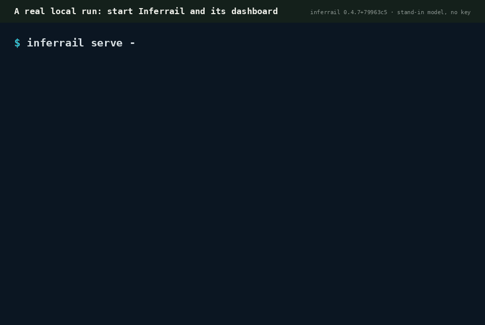

<!-- mcp-name: io.github.domondi1/inferrail -->

<p align="center">
  
</p>

<h1 align="center">Inferrail</h1>

<p align="center">
Spending limits, receipts and paid execution for AI agents.<br>
Give each AI job a dollar budget that's enforced before the provider is called,
and a cost receipt that never stores what the model said.
</p>

<p align="center">
  <a href="https://github.com/domondi1/inferrail/actions/workflows/ci.yml"></a>
  <a href="https://pypi.org/project/inferrail/"></a>
  <a href="LICENSE"></a>
</p>

<p align="center">
  <a href="#quickstart"><b>Quickstart</b></a> ·
  <a href="#for-agents">For agents</a> ·
  <a href="#how-it-works">How it works</a> ·
  <a href="#documentation">Docs</a> ·
  <a href="https://tryinferrail.com/">tryinferrail.com</a>
</p>

<p align="center">
  
</p>

<p align="center"><em>A real run of the gateway and dashboard with a local stand-in model: one job with a $0.04 limit, four calls answered, two refused with HTTP 402 before reaching the model. <a href="docs/assets/dashboard-capture/">How it was recorded</a></em></p>

## What works today

Developer preview: interfaces may change before 1.0.

| Capability | What it does | Where | Status |
|---|---|---|---|
| **Gateway** | OpenAI- and Anthropic-compatible proxy you run yourself. A dollar budget per job, shared by parallel calls; a call that would exceed it gets HTTP 402 before the provider. | `pip install inferrail` | Available |
| **Cost receipts** | One record per call: tokens, price, cost, status, your tags. Never prompts or responses. Totals by job, customer or any tag. | local SQLite or JSONL | Available |
| **MCP server** | Read-only `get_spend` and `get_health` tools over your local receipts. | `inferrail mcp` | Preview |
| **Inferrail Hosted** | The same per-run budgets run for you, shared across agents and machines. 250 runs a month free, then USDC credits over x402. Bring your own provider key. | [hosted guide](hosted/budget_gateway/README.md) | Preview |
| **Web Read** | One public web page as clean markdown with a receipt, paid per call by the agent over x402 or MPP. | [below](#for-agents) | Preview |
| **Agent purchases under a job budget** | One budget covering model calls and x402 purchases; a purchase that doesn't fit is refused before it's signed. Local proof, no mainnet. | [example](examples/agent_economy/) | Experimental |

Also experimental: [AP invoice-exception recovery](docs/capabilities/ap-invoice-exception-recovery.md),
a [hosted trial gateway](https://tryinferrail.com/try/), and
[Work Economics](docs/capabilities/work-economics.md) / [Economic Authority](docs/capabilities/economic-authority.md)
([example](examples/economic_authority_session.py); Base Sepolia testnet only).

## Quickstart

Requires Python 3.11+.

**Try it offline.** No API key, no network calls, no provider charges:

```bash
pip install inferrail
inferrail demo
inferrail report --by customer --receipts ./inferrail-demo-receipts.jsonl
```

The demo sends scripted requests through the real engine to a fake provider with made-up
prices labelled `DEMO`, and prints what they cost by customer.

**Give one run a budget, inside your Python app.** No config file, no second process:

```python
import inferrail
from openai import OpenAI

base_url = inferrail.start()   # the gateway, on a background thread in this process
client = OpenAI(base_url=base_url, api_key="unused")   # your key stays in OPENAI_API_KEY
client.chat.completions.create(
    model="gpt-4o-mini",   # any model your account can use; `inferrail models` lists priced ones
    max_tokens=200,
    messages=[{"role": "user", "content": "Summarize this contract."}],
    extra_headers={
        "X-Inferrail-Attribute-Work-Id": "contract-review-42",   # the run
        "X-Inferrail-Budget-Usd": "0.50",                        # its dollar ceiling
    },
)
```

Every call with the same work id shares that budget, including parallel calls; one that would
push the run past it gets HTTP 402 before it reaches OpenAI. `inferrail work contract-review-42`
shows what the run cost.

More: [run it as a shared gateway with the local dashboard](docs/self-hosting.md),
[framework snippets](docs/recipes/agent-run-budget.md#framework-snippets) (LangChain, LangGraph,
OpenAI Agents SDK, CrewAI, Haystack, LlamaIndex, Microsoft Agent Framework), and
[other clients](docs/integrations.md), including the Anthropic SDK.

## For agents

Start at **[tryinferrail.com/llms.txt](https://tryinferrail.com/llms.txt)**: what's live, with
links to each service's guide and the
[OpenAPI contract](https://inferrail-cost-gateway.onrender.com/openapi.json).

**Web Read** sells one public web page as clean markdown, with its word count, a SHA-256 of the
content and a receipt. **$0.002 per delivered page**, paid over [x402](https://x402.org) (USDC
on Base) or [MPP](https://mpp.dev) (Tempo); no account or API key. The payment is checked first
and settled only after the page is delivered, so refusals (robots.txt, non-public addresses,
non-text, over 2 MB, target-site errors) are never charged. Retrying the same `url` and
`request_id` from the same wallet within 10 minutes returns the page already paid for.

```bash
curl -i -X POST https://inferrail-cost-gateway.onrender.com/read/v1/page \
  -H 'content-type: application/json' -d '{"url": "https://example.com/"}'
# HTTP 402 with the price; an x402 or MPP client pays and repeats the request
```

Guides: [Web Read](https://inferrail-cost-gateway.onrender.com/read/llms.txt) ·
[Hosted](https://inferrail-cost-gateway.onrender.com/hosted/llms.txt) ·
[service source](hosted/web_read/README.md).

**MCP.** Ask your agent what a job cost, from your local receipts:

```bash
claude mcp add inferrail \
  -e INFERRAIL_RECEIPTS_PATH=/absolute/path/to/inferrail-receipts.jsonl \
  -- uvx --with "mcp>=2.0" inferrail mcp
```

Two read-only tools, `get_spend` (known cost and tokens by provider, model, route or any tag
such as `work_id`) and `get_health`. They don't run inference, write files or pay for anything.
Other clients: [docs/integrations.md](docs/integrations.md#mcp).

## How it works

<picture>
  <source media="(prefers-color-scheme: dark)" srcset="docs/assets/inferrail-flow-dark.svg">
  
</picture>

The gateway routes each request by `model` to a configured provider, checks any budget in
scope, forwards the call, and writes one receipt per request, including requests a budget
refused. A cost is recorded only when the provider reports usage and a price is on file;
otherwise it's `unknown`, never a guessed `$0`.

| Where | What it sees or keeps |
|---|---|
| **Your provider** | The full request, exactly as it would without Inferrail, under the provider's own policies. |
| **The gateway, in memory** | Your provider key (from its own environment) and the prompts and responses it forwards. |
| **Receipts, on your disk** | Provider, model, token usage, the price used and the cost, status, timing, and the attribution tags you send. |
| **Not in receipts** | Prompt and response bodies. |

Attribution tags are stored as sent, so keep secrets and message content out of them.
`inferrail verify-payload-free` prints the live receipt schema, and canary tests check that
message bodies never reach receipts; neither is a security audit. The optional usage beacon
sends nothing unless an endpoint is configured ([details](docs/privacy/usage-ping.md)).
Architecture: [docs/ARCHITECTURE.md](docs/ARCHITECTURE.md).

## Current support

- **Endpoints:** `POST /v1/chat/completions` (OpenAI-compatible) and `POST /v1/messages`
  (Anthropic-compatible), with streaming and tool calls, plus `GET /v1/models`.
- **Providers:** OpenAI, Anthropic, and endpoints compatible with either. Built-in prices cover
  OpenAI and Anthropic models; others need a price in your config, or their cost stays unknown.
- **Not supported:** the OpenAI Responses API, embeddings, image generation, audio and Realtime,
  batch, and native Gemini or Bedrock APIs. Fields the gateway can't account for are rejected
  with a clear error, never silently dropped.
- **Scope:** only calls through a running gateway are counted.

Exact contract and non-goals: [docs/PRODUCT.md](docs/PRODUCT.md).
Running agent jobs that spend real money?
[Open a production setup request](https://github.com/domondi1/inferrail/issues/new?template=production-setup.yml).

## Documentation

- [Give one AI agent run a dollar budget](docs/recipes/agent-run-budget.md)
- [Integrations](docs/integrations.md): SDKs, frameworks, attribution, MCP, voice
- [Self-hosting](docs/self-hosting.md): install, configuration, storage, budgets, dashboard
- [Product scope](docs/PRODUCT.md) and [architecture](docs/ARCHITECTURE.md)
- Machine-readable: [llms.txt](llms.txt), [openapi.json](openapi.json) (the gateway),
  [config.schema.json](config.schema.json)

## Contributing, security, license

Questions and bugs: [GitHub issues](https://github.com/domondi1/inferrail/issues).
Security or privacy vulnerabilities: report privately, as described in
[SECURITY.md](SECURITY.md). Contributing: [CONTRIBUTING.md](CONTRIBUTING.md)
(`pytest` needs no API key or network). License: [Apache-2.0](LICENSE).
